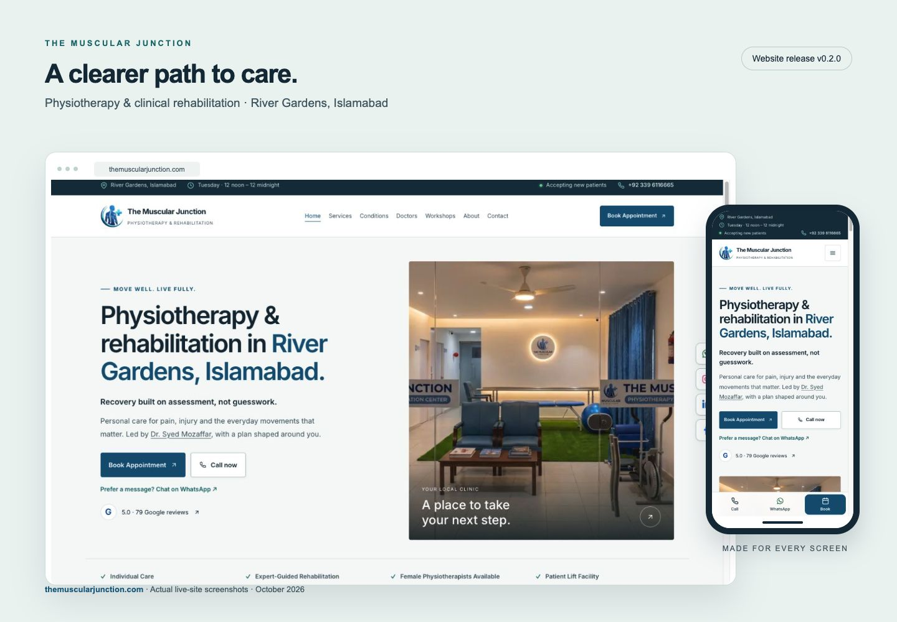
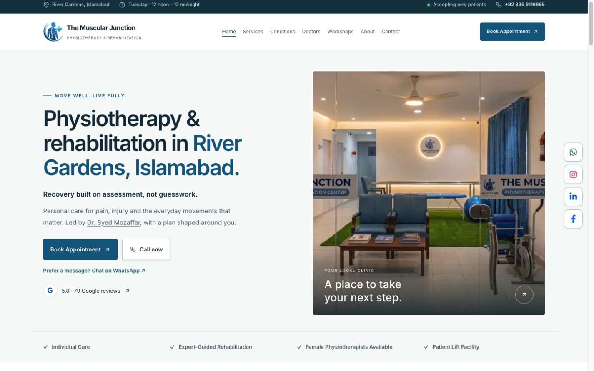
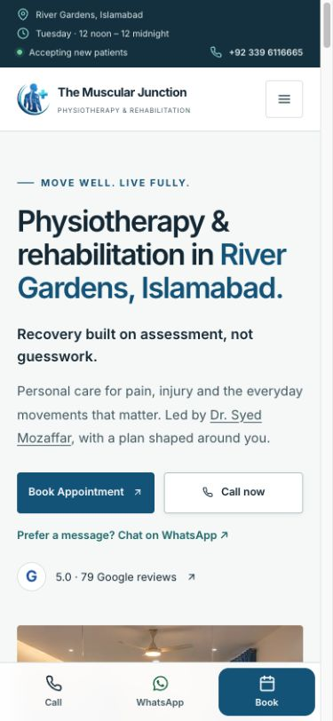

# The Muscular Junction

**Physiotherapy & Clinical Rehabilitation · River Gardens, Islamabad**

[](https://themuscularjunction.com)
[](https://github.com/AlgoBee-Sol/tmj-website/releases/tag/v0.2.0)

[Visit the live website](https://themuscularjunction.com) · [Meet Dr. Syed Mozaffar](https://themuscularjunction.com/doctors/dr-syed-mozaffar) · [Release notes](CHANGELOG.md)

## Website preview

Desktop and mobile views captured from the live website for **v0.2.0**.

[](https://themuscularjunction.com)

<details>
<summary>View individual desktop and mobile screenshots</summary>

### Desktop



### Mobile



</details>

## Features

- Responsive clinic website with conditions, services, clinician profiles, workshops and patient education.
- Clear booking, calling, WhatsApp and directions links; current-day clinic hours use Pakistan time.
- Centralized business content, accessible navigation and structured data.
- All 20 original content URLs preserved; 43 canonical pages and four permanent aliases.

## Technology

Next.js 16 App Router, React 19, TypeScript and Tailwind 4. Cloudflare Workers deployment uses the existing OpenNext adapter and Wrangler configuration.

## Local development

```sh
npm ci
npm run dev -- --hostname 127.0.0.1
```

Open http://127.0.0.1:3000. Production verification:

```sh
npm run lint
npm run typecheck
npm test
npm run build
npm run start -- --hostname 127.0.0.1 --port 3001
# In another terminal:
npm run check:site
```

`CHECK_SITE_URL` can override the HTTP audit target. The audit writes `docs/route-verification.json`. `npx opennextjs-cloudflare build` verifies the Cloudflare bundle without publishing. Use `npm run preview` for the Cloudflare runtime locally. `npm run deploy` builds and publishes the Worker. Pushing `main` also triggers the existing Cloudflare Workers Builds integration. Production targets `tmj-website` at `themuscularjunction.com`; keep the matching custom-domain configuration in `wrangler.jsonc`. See [Cloudflare’s OpenNext guide](https://developers.cloudflare.com/workers/framework-guides/web-apps/nextjs/) for the existing deployment architecture.

## Editing content

| Source | Purpose |
| --- | --- |
| `src/data/site.json` | Business address, phone, maps, social profiles, approved review snapshot and opening times |
| `src/lib/site.ts` | Derived display hours, contact links and preferred production URL |
| `src/data/doctors.json` | Team biographies, credentials, images and publication flags |
| `src/data/services.json` | Service detail content, FAQs and condition relationships |
| `src/data/condition-pages.json` | Condition guides, sources, red flags and related content |
| `src/data/workshops.json` | Topic archives and independently dated events |
| `src/data/articles.json` | Articles, author, categories, dates and related content |
| `src/data/blog-categories.json` | Editorial category vocabulary |
| `src/data/confirmation.json` | Factual approvals and remaining editorial checks |
| `src/data/redirects.json` | Permanent aliases; existing public URLs are retained |

Hours are entered once as 24-hour `opens`/`closes` values and day names; visible hours and structured data derive from them. Midnight closing is `00:00`. Update the review count/value and verification date together after owner verification; `confirmed: false` displays a neutral review link. Never add unverified qualifications or clinician-review claims.

Workshops with ISO timestamps include a timezone offset (`+05:00`). Status changes after `endDate` without rebuilding because workshop pages render dynamically. Programme archives have no invented dates or Event markup. Add real licensed photographs to `public/images` and reference them in the workshop `photos` list when available. Adding a content record updates the corresponding generated route and sitemap; related IDs must resolve. Run tests and the HTTP audit after changes.

## Booking and privacy

The default form validates details locally and prepares a WhatsApp draft. Visitors review it, choose to open WhatsApp and send it themselves. It does not create a confirmed booking, store requests on the website, or solicit medical history. Invalid input has accessible errors; a honeypot is included. Clinic time is Asia/Karachi.

Optional EmailJS delivery activates only when all three existing `NEXT_PUBLIC_EMAILJS_SERVICE_ID`, `NEXT_PUBLIC_EMAILJS_TEMPLATE_ID`, and `NEXT_PUBLIC_EMAILJS_PUBLIC_KEY` variables are configured. They are browser identifiers, never a place for private keys. The optional integration was not live-tested because no provider configuration exists locally. Configure provider origin restrictions and abuse controls before enabling it; the client cooldown and honeypot are not server-side rate limiting. Align the template with the allowlisted booking fields. The WhatsApp route remains available if delivery fails.

No analytics provider was configured or added. Google Maps loads only when the visitor requests the interactive map. `NEXT_PUBLIC_GOOGLE_SITE_VERIFICATION` supports an existing Search Console verification token.

## Release and maintenance

Version numbers in `package.json` and `package-lock.json` are kept in sync. Releases use annotated Git tags, starting with `v0.2.0`; changes are recorded in [CHANGELOG.md](CHANGELOG.md). The visual mockup uses real live-site screenshots, not generated clinic imagery.

## Handoff

See [implementation report](docs/implementation-report.md), [baseline audit](docs/audit-before.md), [original route inventory](docs/routes-before.json) and [automated route results](docs/route-verification.json).
